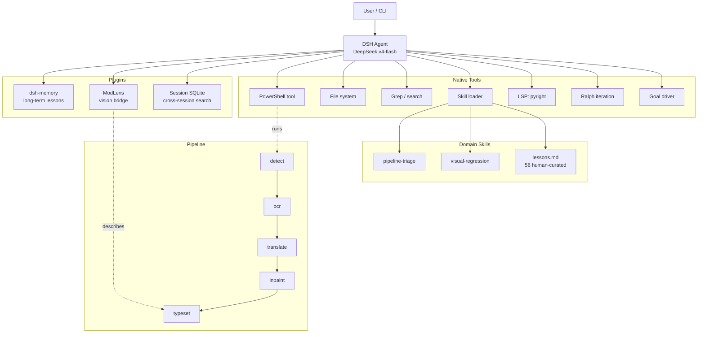

# ADR: Migrate to DSH-Native Manga Translator Agent

**Date:** 2026-09-29
**Branch:** `feat/dsh-native-agent-init`
**Status:** Accepted

## Context

The previous architecture wrapped DSH headless CLI in a Python outer loop
(`src/amta/agent_loop/runner.py`) that managed a state machine:
`queued → running → verifying → ready_for_review → accepted`. The outer loop
controlled budget, evidence fingerprints, and independent pytest verification.

The user's core critique was correct: **this was just a high-end headless SDK
wrapper**. The intelligence lived entirely inside DSH; the outer loop merely
automated "human says continue." It was not an autonomous agent — it was a
fixed pipeline that called an AI worker.

## Decision

Replace the custom outer runner with DSH's native agent loop primitives.
Follow **The Bitter Lesson**: give the model general tools and general rules,
let it decide workflow, stop conditions, and verification itself.

### What we kept

| Component | Source | Why |
|-----------|--------|-----|
| Main model | DeepSeek v4-flash | Cheap, fast, already configured |
| Vision backend | Qwen 3.5 omni-plus (DashScope) | Already configured via `describe-image` |
| Vision bridge | ModLens plugin (already installed) | Text model calls `modlens_read_image`, Qwen describes the image |
| Skills | `.dsh/skills/` (6 existing + 2 new) | Progressive disclosure: catalog auto-injected, body on-demand |
| Long-term memory | dsh-memory plugin | Auto-extracts and injects lessons across sessions |
| Code navigation | LSP (pyright-langserver) | goToDefinition / findReferences / hover without grep |
| Session search | session-query-sqlite (persistent) | Full-text search across past sessions |
| Persona | system-prompt.persona | One-line identity: manga translation engineer |

### What we removed

| Component | Replacement |
|-----------|-------------|
| `runner.py` state machine | DSH native `goal` + `goal-round-driver` + `tool-ralph` |
| Custom budget control | DSH native round limits and timeouts |
| Custom evidence fingerprinting | Agent runs pytest itself; visual-regression SKILL.md enforces proof |
| Independent supervisor verification | Deferred: SKILL.md completion criteria first; add PostToolUse hook only if model skips checks |

### What we explicitly did NOT add

- **MCP Server** — Shell tool running Python CLI is enough for now
- **External scheduler** — No cron use case; Windows Task Scheduler if needed later
- **LSP for other languages** — Python only (pyright)
- **Hooks / guards** — Trust the model first; add only after observing a real failure
- **Custom UI** — Use DSH's built-in web UI (localhost)

## New skills added

1. **`pipeline-triage`** — When a stage fails, classify the error, check
   lessons.md, isolate with a probe, verify the fix.
2. **`visual-regression`** — After rendering changes, generate the report,
   inspect specific pages with ModLens, compare before/after, and only declare
   "fixed" when pytest passes AND visual evidence confirms the symptom is gone.

## Configuration changes

### Headless profile (`~/.dsh/profiles/headless/`)

- `cordis.patch.yml`: persona, session-query-sqlite (persistent), LSP stdio (pyright)
- `package.json`: added `@deepseek-ai/dsh-lsp`, `dsh-lsp-stdio`, `dsh-tool-lsp`, `dsh-memory`

### Web profile (`~/.dsh/profiles/web/`)

- `cordis.patch.yml`: removed `modlens disabled: true` — vision now active

## Architecture diagram

## Open questions / deferred

- If the model repeatedly skips verification, add a `PostToolUse` hook on pytest.
- If code navigation becomes a bottleneck beyond LSP, consider TS/JS LSP later.
- If visual inspection needs are more complex, evaluate a vision subagent (fork with Qwen).
